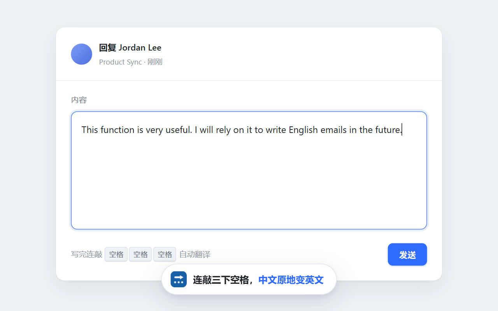
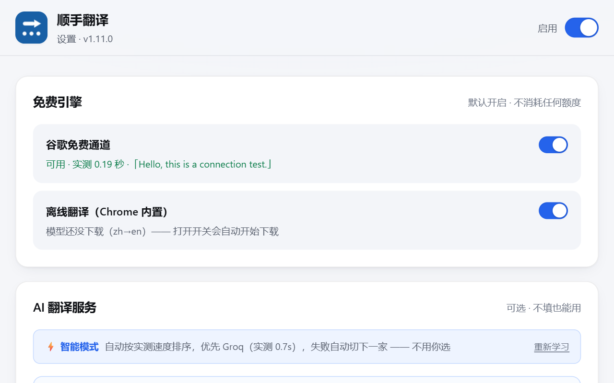
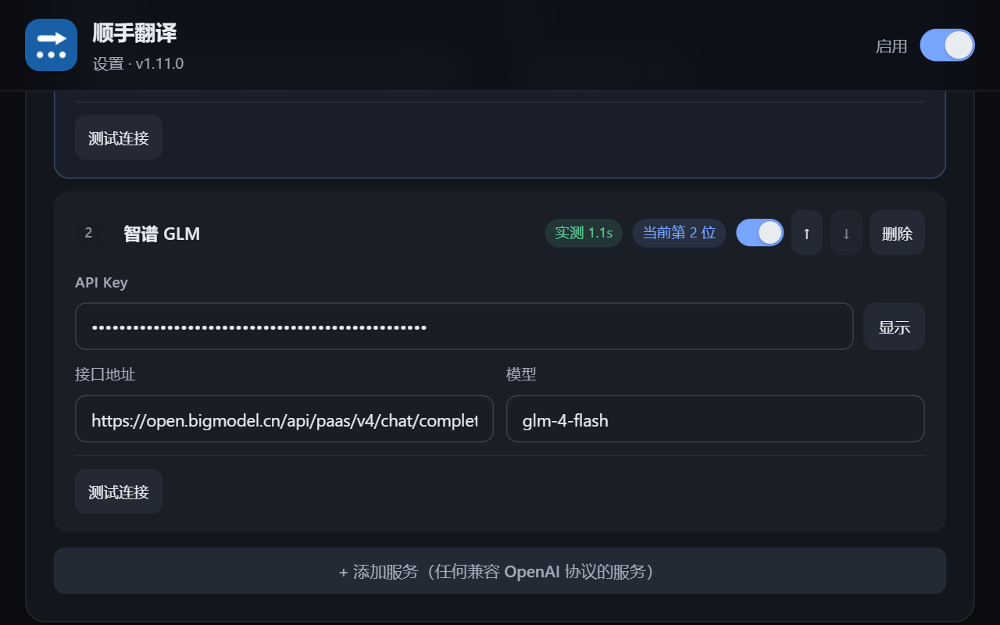

# 顺手翻译

在任意网页的输入框里写完中文，**连敲三次空格**，内容立刻变成目标语言并原地替换。

**装完就能用，不需要申请任何 API Key。** 默认走免费通道（Chrome 内置离线模型 + 谷歌免费通道）；
想要更好的译文质量，再自己加一家 AI 服务商，不填也不影响使用。

[](LICENSE)
[](manifest.json)
[](SECURITY.md)

```
chrome://extensions → 开发者模式 → 加载已解压的扩展程序 → 选这个文件夹
```

> 完整步骤见 [安装](#安装)。安全设计（Key 存在哪、会不会外泄）见 [SECURITY.md](SECURITY.md)。



<details>
<summary>设置页（点击展开亮色 / 暗色）</summary>

| 亮色 | 暗色 |
|---|---|
|  |  |

</details>

---

## 功能

| 功能 | 状态 |
|---|---|
| 输入框三连空格翻译（`input` / `textarea` / `contenteditable`） | ✅ 已完成 |
| 中文输入法防误触 | ✅ 已完成 |
| 兼容 React / Vue 受控组件 | ✅ 已完成 |
| **弹窗快捷翻译（任意页面可用，含新标签页）** | ✅ 已完成 |
| **免费引擎：离线翻译（Chrome 内置，~0.02s）+ 谷歌免费通道（~0.5s）** | ✅ 已完成 |
| **多服务商 + 自动故障转移** | ✅ 已完成 |
| **智能模式：自动实测速度，永远用最快的（全自动）** | ✅ 已完成 |
| **模型下线自愈：服务商偷偷下线模型时自动换成新模型** | ✅ 已完成 |
| **限流冷却：刚挂掉的接口短时间内不再打扰** | ✅ 已完成 |
| **本地翻译缓存（省额度、秒出结果）** | ✅ 已完成 |
| 多目标语言（14 种） | ✅ 已完成 |
| 语气风格（自然 / 正式 / 直译） | ✅ 已完成 |
| 站点黑名单 | ✅ 已完成 |
| **暗色模式（跟随系统）** | ✅ 已完成 |
| **版本自检：后台跑旧版时设置页自动亮红灯**（排查「改了没生效」） | ✅ 已完成 |
| 页面段落翻译（`Ctrl+Shift+L`） | ⏳ 计划中 |
| 原位整页翻译（`Ctrl+Q`） | ⏳ 计划中 |

---

## 界面

设置页和弹窗**跟随系统的深浅色设置自动切换**，不需要手动开关。
深色下不是简单地把白底换成黑底 —— 主色会提亮、语义色（成功/警告/错误）会重新配比，
保证对比度够用。

设计上参考了开源项目 [wandb/openui](https://github.com/wandb/openui) 的做法：

| 做法 | 好处 |
|---|---|
| **颜色只以语义令牌出现**（`--text` / `--border` / `--blue-soft`…），规则里不写死色值 | 暗色模式只需重声明一遍同名令牌，不必逐条改规则，也不会漏改某处导致夜里闪一块白 |
| **圆角由一个基准值派生**（`--r-sm/md/lg/pill`） | 不会出现 6/8/10/12px 各写各的 |
| **焦点环只给键盘用户**（`:focus-visible`） | 鼠标点击不出现难看的框，键盘 Tab 时清晰可见 |
| **加载态用骨架条**，不写「加载中…」 | 一眼看出是在加载；文字仍留在 DOM 里给读屏软件 |
| **尊重 `prefers-reduced-motion`** | 系统开了「减少动态效果」就不播动画 |

> 渲染测试会在亮色和暗色两种模式下各跑一遍，并断言**暗色下不存在任何纯白底元素** ——
> 一旦有人往 CSS 里写死 `background: #fff`，测试立刻失败。

---

## ⚠️ 新标签页用不了三连空格（Chrome 平台限制）

**这是 Chrome 的安全限制，不是插件的 bug，任何扩展都做不到。**

Chrome 新标签页的地址是 `chrome://newtab` 或 `chrome-search://local-ntp` —— 属于**浏览器内置页面**。
出于安全考虑，Chrome **禁止任何扩展**往这类页面注入脚本（`<all_urls>` 也匹配不到 `chrome://` 协议）。
「沉浸式翻译」等所有同类插件在原生新标签页上同样无效。

**替代方案：用弹窗里的「快捷翻译」。**

1. 点工具栏的插件图标，或按快捷键 `Alt+Shift+T` 直接唤出。
2. 在「快捷翻译」框里输入或粘贴内容。
3. 按 `Ctrl + Enter`（或点「翻译」），译文立刻显示在下面，可一键复制。

这个框是扩展自己的页面，所以**在任何地方都能用** —— 新标签页、`chrome://settings`、应用商店页都可以。
翻译走的是同一套智能排序 + 缓存，所以又快又省额度。

> 你停在新标签页时打开弹窗，插件会自动识别并把「快捷翻译」框高亮出来。

---

## ⚠️ 「以前好好的，最近总是翻译失败」是怎么回事

**大概率是服务商把模型下线了，而插件不知道。**

免费 AI 服务商会定期下线老模型，而且**不会通知你**。你的配置里还留着老模型名，
接口从此每次都报错（`400 model_decommissioned`，或 `503 model_not_found`）——
看起来像网络问题，其实是配置过期了。2026 年就发生了四起大范围下线：

| 服务商 | 下线的模型 | 时间 | 换成了 |
|---|---|---|---|
| Groq | `llama-3.3-70b-versatile` | 2026-08-16 | `openai/gpt-oss-120b` |
| 智谱 GLM | `glm-4.7-flash` | 2026-10-14 | `glm-4-flash` |
| Agnes AI | `agnes-2.0-flash` | 2026-10 | `agnes-2.5-flash` |

**插件从 v1.5.0 起会自动处理这件事，你什么都不用做：**

1. **自动改配置** —— 读取设置时对照「已下线模型表」，把老模型名换成替代模型（按接口域名匹配，不会误伤你自建的服务）。
2. **识别这类错误** —— 不再把它当成「服务繁忙」反复重试，而是直接判定为配置问题、把这家排到最后并给 5 分钟冷却。
3. **说人话** —— 提示变成「模型「xxx」已不可用，请在设置页更换模型」，点一下就跳到设置页；设置页里那家会标上 **模型已下线，需更换**。

> 如果你用的是**自定义服务商**，插件不会替你猜模型名 —— 请对照服务商文档手动更新。

---

## 安装

**方式一：下载解压（不用装 Git）**

去 [Releases](../../releases) 下载最新的 `agnes-translator-x.y.z.zip`，解压到任意目录，然后按下面第 1–5 步加载。

**方式二：从源码加载**

1. 打开 Chrome，地址栏输入 `chrome://extensions` 回车。
2. 打开右上角的 **开发者模式**。
3. 点击 **加载已解压的扩展程序**。
4. 选择本文件夹（`agnes-translator`）。
5. 在工具栏的拼图图标里找到「顺手翻译」，点图钉固定到工具栏。

> 首次安装会自动打开设置页。**不填任何东西也能用** —— 免费引擎默认就是开的；
> 想要更好的译文质量再去加 AI 服务商。

---

## 为什么能「随时可用」：免费引擎 + 多服务商 + 缓存

单个免费 Key 一定会遇到限流。插件的做法是：

```
输入中文 → 连敲三次空格
        ↓
   ① 查本地缓存 ──命中──▶ 直接返回译文（0 请求、0 延迟）
        ↓ 未命中
   ② 免费引擎（不花任何 AI 额度）
        ├─ 离线翻译（Chrome 内置模型，实测 ~0.02s）
        └─ 谷歌免费通道（实测 ~0.5s）
        ↓ 两层都不行
   ③ 按「实测速度」排序 AI 服务商（最快的先试，冷却中的排最后）
        ↓ 第一家限流/超时/出错
      自动切下一家
        ↓
   ④ 成功后写缓存，并把这次的耗时记进速度统计
```

**整个过程你不需要做任何选择，也不需要手动测速。**

### 免费引擎：为什么不直接用 AI 接口

LLM 是「拿通用大模型去做翻译」——首字延迟 1–5 秒，按 token 计费，免费档还有每日次数上限。
专用翻译通道是「为翻译而生」，快一个数量级，而且大多不要钱。所以顺序是**先免费引擎，再动 AI 服务商**。

| 引擎 | 需要配置 | 实测耗时 | 免费额度 | 质量 |
|---|---|---|---|---|
| **离线翻译**（Chrome 内置） | 首次下载模型（约 21 秒，一次性） | **11–31ms** | 无限，断网也能用 | 良好 |
| **谷歌免费通道** | 无 | 200–2000ms | 无明确上限 | 更好 |

两层都是**纯加速层**：任何一层失败都静默跳到下一层，绝不会因此翻译不了。

> **离线引擎到底有没有用？** 有，但要知道它的代价：
> 用的是 Chrome 138+ 自带的本地模型，模型跑在你自己电脑上，**单句 11–31ms**
> —— 比最快的网络接口还快一个数量级，而且断网可用。
> 代价是**每个语向要单独下一次模型**（zh→en 约 21 秒、几十 MB），所以默认关着；
> 打开开关时才开始下，下完就一直在了。
> 设置页那行状态会直接告诉你是哪对语向、下没下好。
>
> 一句话：**想省那 0.4 秒就开，不想等下载就不开 —— 关了不影响任何功能。**

> **关于谷歌免费通道**：走的是 Chrome 浏览器自己「翻译选中文本」用的内部接口
> （`client=dict-chrome-ex`）。同系列的 `gtx` / `webapp` 已被 Google 封掉（实测 429 / 403），
> 只有这一个还通。它不需要 Key，但也**不是 Google 公开承诺的 API**，
> 所以后面永远接着 AI 服务商兜底。

### 它是怎么自动学出「谁最快」的

两层数据来源，全部自动：

**第一层：真实使用（主力）**
每次翻译都会记录这一家的实际耗时，用指数移动平均（EMA）平滑后参与排序。用得越多越准。

**第二层：后台自动补测（补位）**
对于**还没测出速度**的服务商（刚装好、刚添加、刚改过配置），插件会在后台自动补一次探测，触发时机是：

| 时机 | 说明 |
|---|---|
| 安装 / 升级插件后 | 给已有配置补数据 |
| 浏览器启动时 | 顺手检查，通常什么都不做 |
| 你粘贴完 API Key / 新增服务商后 | 防抖 8 秒，等你填完再测 |
| 每次翻译结束后 | 只针对还没数据的，不会反复消耗额度 |

**这个补测只加分、不扣分** —— 探测失败绝不会让某家降权（那可能只是你的 Key 还没粘贴完），只有真实使用中的失败才会触发冷却。

### 排序规则

| 规则 | 说明 |
|---|---|
| **快的排前面** | 实测平均 1.2s 的排在 2.8s 的前面 —— 用户要的是最快出结果 |
| **样本少时保守** | 只测过 1 次就「特别快」不会立刻霸榜，会向中性值收缩，测满约 4 次才完全采信 |
| **连续失败降权** | 每次连续失败加一层惩罚，刚挂掉的接口不会立刻又被顶到第一位 |
| **冷却期** | 限流 → 冷却 45 秒；超时/服务端错误 → 20 秒；Key 无效 → 5 分钟。冷却中的排到最后 |
| **只是降级，不是跳过** | 冷却中的服务商仍然会兜底尝试 —— 万一别的都不行，它还能救场 |
| **同分时听你的** | 速度一样时，按你在设置页排的顺序来（所以 ↑↓ 仍然有意义） |

**没有任何数据时**（刚装好），顺序就是你在设置页排的顺序 —— 你原本的配置依然有效，插件只是越用越准。

### 缓存

翻过的句子存在本机，重复内容直接返回，**不消耗任何 API 额度**。

---

## 想接 AI 服务商的话

**插件不预置任何服务商，也不替你挑。** 免费通道已经够用；想要更好质量时自己加一家：
设置页 → 「AI 翻译服务」→ **「+ 添加服务」**，填接口地址、模型名、Key 三样就行。
任何兼容 OpenAI 协议（`/v1/chat/completions`）的服务都能接，不限于下面这几家。

下面三家是本机实测跑通过的，纯粹供参考：

| 服务商 | 模型 | 免费额度 | 申请地址 |
|---|---|---|---|
| **Groq** | `openai/gpt-oss-120b` | 每天 14,400 次，实测最快 | <https://console.groq.com/keys> |
| **智谱 GLM** | `glm-4-flash` | 永久免费，国内直连 | <https://bigmodel.cn/usercenter/proj-mgmt/apikeys> |
| **Agnes AI** | `agnes-2.5-flash` | 永久免费，高峰期较慢 | <https://agnes-ai.com/> |

> 实测数据（2026-10-14，本机）：Groq 10/10 成功、均值 734ms；智谱 `glm-4-flash` 5/5、1136ms；
> Agnes `agnes-2.5-flash` 3/3、2055ms。OpenRouter 免费档连续 429、Gemini / Cerebras 同样打不通，
> 所以没列 —— 但你手上要是有能用的 Key，照样可以加。

> **为什么不做「快速添加」了？** 那排按钮等于替你选定了几家供应商，开源版本里还容易被读成夹带推广。
> 宁可让你多填两个字段，也不替你做选择。

> **建议加 2 家以上**：一家限流时自动切下一家，不用你手动调顺序。

---

## 使用方法

1. 在任意网页的输入框里输入中文。
2. **快速连敲三次空格**（默认需在 500 毫秒内完成）。
3. 第三次空格会被自动拦截，输入框内容整体替换为译文。
4. 输入框右下角出现状态提示：
   - `缓存命中` —— 命中本地缓存，瞬时返回
   - `1.6s · 已切到 Groq` —— 主力服务失败，自动切换后成功
   - `2.1s · 已翻译 → English` —— 正常翻译

**注意：**

- 连敲间隔超过时间窗口，计数会重置，需要重新来。
- 翻译通常 1～3 秒，期间请稍等。
- 如果翻译期间你改动了输入框内容，插件**不会覆盖**你的新内容，而是把译文复制到剪贴板并提示你。

---

## 敲了三次空格没反应？按这个顺序排查

**第 0 步：点开工具栏的插件图标，看最上面那行「当前页面」状态。** 它会直接告诉你问题在哪：

| 提示 | 含义 | 怎么办 |
|---|---|---|
| 🟢 当前页面已就绪 | 一切正常 | 那就是所有服务商都限流了，看下面 |
| 🔴 这个页面还没加载插件 | 页面是安装/更新插件之前打开的 | 按 `F5` 刷新页面 |
| 🔴 此页面不支持 | 你在 `chrome://`、扩展页或新标签页 | 换个普通网页测试 |
| 🟡 插件已停用 | 开关被关了 | 打开面板上的开关 |
| 🟡 xx 在黑名单里 | 该站点被排除 | 到设置页把域名删掉 |
| 🟢 免费引擎已就绪 | 没配 AI 服务商，但免费通道能用 | 什么都不用做，直接翻 |
| 🟡 还没有可用的翻译服务 | 免费通道关了，服务商也没配 | 打开免费引擎，或到设置页加一家 |

面板中间还会显示 `N / M 家服务可用`，以及 `⚡ 智能模式 · 优先使用 X（实测 1.2s），失败自动切换` —— 直接告诉你这一下会走哪家。可用数越多，越不容易全部限流。

**如果状态是 🟢 但仍没翻译**，通常是所有已配置的服务商同时限流。这时候：

- `翻译中…` → 正常，等 2～5 秒
- `翻译中…（服务繁忙，自动重试中）` → 触发限流，插件正在自动重试
- `N 家服务都失败了 · 点击重试` → 全部失败，**点一下这行提示**即可再试

**根治办法**：到设置页多加两家免费服务商（推荐 Groq + 智谱 GLM），一家挂了自动切下一家。刚挂掉的那家会自动进入冷却期，短时间内不会再被优先尝试，所以你不用手动去调顺序。

---

## ⚠️ 看到 `免费额度请求过于频繁，已重试仍未成功，请等 1 分钟再试`？

**这条提示是本插件的 —— 但属于一个很老的版本（v1.0），新版早就没这句话了。**

新版的限流提示只有 5 个字：`免费额度已限流`。看到上面那一长串，说明**浏览器里跑的仍是旧版代码**。

**结论：你装完这个插件之后，从来没有在 `chrome://extensions` 里点过刷新按钮。**
Chrome 把最初装进去的那份 Service Worker 一直用到现在。修法只有一条：

1. 打开 `chrome://extensions`，找到「顺手翻译」，点一下 **⟳ 刷新**（或直接删掉重新加载）；
2. 回到已打开的网页按 `F5`（内容脚本是页面加载时注入一次的，不刷新不会换）；
3. 重开设置页 —— 顶部那条黄色告警会自己消失。

### 为什么改了代码还跑旧版

Chrome 有两条缓存，都可能让你「改了没生效」：

1. **扩展本身没重新加载** —— `chrome://extensions` 里没点那个刷新按钮，
   Service Worker 会一直用启动时加载的那份脚本。
2. **已经打开的网页里还是旧的内容脚本** —— 内容脚本是**页面加载时注入一次**的，
   之后你刷新扩展，**已打开的标签页不会自动换**，得按 `F5`。

### 不用自己判断 —— 设置页会自动亮红灯

**设置页和弹窗顶部，只要出现一条黄色告警，就说明后台还在跑旧版本、改动没生效。**

设置页的告警长这样：

```
⚠️ 后台还在跑旧版本，改动没生效
   这个页面读的是磁盘上的代码（v1.9.0），但负责翻译的后台仍是 v1.0.0。
   翻译会继续用旧逻辑 —— 这正是「改完还是老样子」的原因。
   点下面按钮打开扩展管理页，找到「顺手翻译」，按一下 ⟳ 刷新，然后关掉本页重开。
   [打开扩展管理页]  [复制地址]
```

弹窗里则是窄版的一行：`后台还在跑旧版本 v1.0.0` + `去刷新` 按钮。

没出现这条告警 = 版本一致，改动已经生效。

页头左上角还会常驻显示当前实际加载的版本号（`设置 · v1.9.0`），鼠标悬停能看到磁盘版本对比。

#### 它是怎么判断的

三个版本号对不上就报警：

| 来源 | 取值方式 | 含义 |
|---|---|---|
| **磁盘版本** | `fetch(chrome.runtime.getURL('manifest.json'))` | 你刚改完的代码 |
| **页面版本** | `chrome.runtime.getManifest().version` | 页面内存里那份 manifest |
| **后台版本** | 向 Service Worker 发 `swPing` | 真正在跑翻译逻辑的那份代码 |

关键在第三个：**后台收不到 `swPing` 的回应，就说明它是旧代码**（这条消息是新版才加的）。
这样即使磁盘和页面的版本号碰巧一样（比如你只改了 `background.js` 没改版本号），也能被发现。

> 这个自检是踩坑之后补的：扩展的**页面**（`options.html` / `options.js`）是浏览器直接从磁盘读的，
> 所以改完代码一开设置页就是新的；但**后台 Service Worker** 会被 Chrome 连同注册信息一起缓存住，
> 在 `chrome://extensions` 点刷新之前一直跑最初装进去的那份代码。
> 表现出来就是「设置页看着是新的，翻译行为还是老的」—— 光看界面根本发现不了，
> 曾经为此浪费了一整轮排查。现在它会自己喊出来。

---

## 三连空格被别的插件抢了？（另一种情况）

**「沉浸式翻译」也有一个「输入框翻译」功能，触发方式一模一样：连按 3 次空格。**

**前提：它必须处于「启用」状态。** 如果你在 `chrome://extensions` 里看到它是灰的（已停用），
那它不执行任何代码，**不可能弹出任何提示** —— 排查时先确认这一点，别浪费时间。

两个插件都启用并抢同一个手势时，会出现：

- **同一个输入框被翻译两次**，白白消耗两边的额度，更容易触发限流。
- 两边都想拦截那第三个空格，偶尔会互相打断。

**解决办法（二选一）：**

1. **推荐**：打开「沉浸式翻译」→ 设置 → 找到 **「输入框翻译」** → **关掉它**。
2. 或者：把本插件的触发改成 **2 次 / 4 次 / 5 次空格**（设置页 →「连敲空格次数」），和它的 3 次错开。

> **排查「界面上一句莫名其妙的提示是从哪来的」方法论**（踩过坑，记下来）：
> 别靠猜，按顺序做四件事 ——
> ① 在 `chrome://extensions` 确认哪些插件是**启用**的（停用的一定清白）；
> ② 在扩展目录里 `grep` 这句文案；搜不到就说明**不是当前源码**发出的；
> ③ **去 Chrome 的脚本缓存里搜**：
> `User Data/Default/Service Worker/ScriptCache/`（Service Worker 的模块脚本）和
> `User Data/Default/Extension Scripts/`（内容脚本）。旧版代码从源文件里删掉之后，
> **仍然会留在这些缓存里** —— 本文开头那条提示就是这么找到的；
> ④ 找到之后**别急着下结论说「是缓存的问题」**。缓存里有旧代码是常态，
> 真正要回答的是「**为什么 Chrome 还在跑这份缓存**」。
> 去看 `Secure Preferences` 里本扩展的 `service_worker_registration_info.version` ——
> 如果它和磁盘上的 `manifest.json` 版本对不上，答案就是：**装完之后从来没点过刷新**。
> 这时唯一的修法是去 `chrome://extensions` 点 ⟳（或者干脆删掉重新加载），
> 改源码、改版本号都不会有用。

---

## 设置项说明

### 翻译服务

| 设置 | 说明 |
|---|---|
| 智能模式 | 常开，无需配置。按实测速度自动排序，永远优先用最快的那家 |
| 添加服务 | 底部按钮，点一下生成一张空白卡片（不预填任何厂商） |
| 服务卡片 | 每家一张卡，可改名称、API Key、接口地址、模型 |
| 实测标记 | 卡片上显示 `实测 1.2s` / `测速中…` / `冷却中 30s` |
| 启用 / 停用 | 每张卡右上角有独立开关，临时停用不用删掉 |
| 测试连接 | 单独测这一家是否通（可选，平时不需要用），结果也会写进速度统计 |

> **「测试连接」显示「配置可用 · 服务商当前限流」是正常的。** 429 说明鉴权已经通过、
> 只是免费池被挤爆了（智谱免费档高峰期常回 429，Agnes 免费池也会），
> **不是 Key 填错了**，不用反复重填。真正填错 Key 会显示 `API Key 无效或已失效（HTTP 401）`。
| 重新学习 | 智能模式说明条右下角一个不起眼的小链接。只在你想清空历史速度数据、让它从头学一遍时才用 |

> 卡片本身的排列**不会**因为智能模式而跳动 —— 它始终是你配置的顺序；
> 真正生效的顺序显示在顶部那条「智能模式」说明里（它会直接点名当前最快的那家）。

### 免费引擎

| 设置 | 说明 |
|---|---|
| 谷歌免费通道 | 默认开启。零配置、不需要 Key，实测约 0.44 秒。开关下方实时显示当前通不通、延迟多少 |
| 离线翻译（Chrome 内置） | 默认关闭。打开时自动下载模型（约 21 秒，一次性），之后单句 11–31 毫秒、断网可用。状态行会写明是哪对语向 |

> 两层都排在 AI 服务商前面。都关掉就只走 AI 服务商。
> 如果离线模型一时下不动，**不影响使用** —— 那次会先用谷歌通道翻译，
> 并在你下次三连空格时继续尝试下载。

### 触发与翻译

| 设置 | 说明 |
|---|---|
| 连敲空格次数 | 默认 3 次，可改为 2 / 4 / 5 次 |
| 连击时间窗口 | 默认 500 毫秒 |
| 目标语言 | 14 种语言可选，默认英语 |
| 语气风格 | 自然口语 / 正式书面 / 忠实直译 |

### 缓存与站点

| 设置 | 说明 |
|---|---|
| 本地缓存 | 默认开启，可随时关掉；面板显示已缓存条数、命中次数、占用大小 |
| 清空缓存 | 一键删除所有已缓存译文 |
| 黑名单域名 | 每行一个域名，命中后该站点不启用翻译 |

所有设置**修改后自动保存**，无需手动点击保存。

---

## 安全与隐私

这个插件会接触两类敏感信息：**你填的 API Key** 和 **你输入框里的文字**。处理方式如下。

### API Key 存在哪、谁能碰

| 位置 | 能否看到 Key | 说明 |
|---|---|---|
| `chrome.storage.local` | ✅ 存的就是它 | 只在本机 Chrome 配置目录里，**不走 `storage.sync`**，不会同步到谷歌账号 |
| 后台 Service Worker | ✅ 只在发请求那一刻用 | 翻译请求由它发起，Key 只出现在 `Authorization` 头里 |
| 设置页 / 弹窗 | ✅ 仅设置页，`type="password"` | 需要你手动点「显示」才明文 |
| **内容脚本**（注入到网页的那个） | ❌ **读完立刻剥离** | 只留 `hasKey: true/false`。网页的 JS 即便被攻破也拿不到 |
| 网页本身 / 任何第三方 | ❌ | 没有 `postMessage`、没有把 Key 写进 DOM、没有注入页面上下文 |

**其它措施：**

- **错误文本脱敏**：服务商返回的报错在显示前会过一遍 `redactSecrets()`，
  把本次的 Key、以及任何 `Bearer xxx` / `sk-xxx` / `gsk_xxx` / `AIza...` 形态的串抹成 `[已隐藏]`。
  防的是自建代理/中转网关把请求头回显进错误响应，再被你截图发出去。
- **零日志**：全项目没有一处把 Key 写进 `console`。
- **零上报**：没有任何统计、埋点、崩溃收集。插件不会主动连接除翻译服务商以外的地址。

### 你输入的文字去哪了

- 只在你**主动触发**（连敲三次空格 / 点弹窗翻译）时，读取**当前聚焦的那个输入框**的内容。
- 页面上的其它内容一概不读。
- 文字会发给你启用的翻译通道（免费通道或你配置的服务商）——这是翻译本身的必要动作。
- 翻译结果缓存在本机 `chrome.storage.local`，默认 30 天，设置页可一键清空，也可整个关掉。

### 如果你要 fork 或二次开发

- 仓库里**没有任何真实 Key**。截图里的 Key 是 `gsk_demo_...` 这种一眼假的占位符。
- `.gitignore` 已经排除 `.dev-keys.json`、`.env`、`dist/`。别把本地调试用的 Key 提交上来。
- 提交前建议跑一遍 `node tools/test_modules.mjs`，其中第 14 节专门断言「错误文本里不得出现 Key」。

### 权限说明

插件申请了 `<all_urls>`，因为内容脚本必须能在任何网页的输入框里工作。
安装时 Chrome 会提示「读取和更改您在所有网站上的数据」—— 这是注入内容脚本的必要权限，
但插件**不读取页面正文**，只在触发时读取当前输入框。

---

## 常见问题

**Q：敲了三次空格没反应？**
先点开工具栏的插件图标，看最上面那行「当前页面」状态 —— 它会直接告诉你原因。详见上面「敲了三次空格没反应？按这个顺序排查」。

**Q：需要我手动测速 / 手动选服务商吗？**
不需要。插件自己会测、自己会选，你只需要把 Key 填进去。设置页上那排小字（`实测 1.2s`、`当前第 2 位`）只是把它的判断结果告诉你，方便你确认，不是要你操作。

**Q：它什么时候会去测速度？会不会浪费我的免费额度？**
只在**这家还没测出过速度**的时候测一次，触发点是：装好插件、浏览器启动、你粘贴完 Key / 新增服务商（防抖 8 秒等你填完）、以及每次翻译结束后顺手补一次。已经有数据的不会再测 —— 之后全靠真实使用持续更新，几乎不额外消耗额度。

**Q：为什么我新加的一家明明很快，却没排到第一？**
前几次它会先「保守」一点 —— 只测过 1 次就特别快，不足以说明问题（可能刚好网络空闲）。测满约 4 次后就会完全按实测速度排，正常用几次就准了，不用管它。

**Q：一家服务商被限流后，插件还会一直去撞它吗？**
不会。限流后进入 45 秒冷却期，这段时间它会被排到最后、优先用别的；冷却结束后自动回到正常排序。冷却只是降级、不是拉黑 —— 万一其它都不行，它仍然会兜底尝试。

**Q：测速数据存在哪？会上传吗？**
只存在你本机的扩展存储里（`chrome.storage.local` 的 `providerStats`），不上传任何服务器。想清空可以点智能模式说明条右下角的「重新学习」。

**Q：真的能一直免费吗？**
组合起来可以。Groq 每天 14,400 次 + Agnes 永久免费 + 本地缓存，日常打字翻译的用量远低于任何一家的额度。全部服务商同时限流的概率极低。

**Q：缓存会不会把旧译文一直留着？**
缓存按「目标语言 + 语气 + 原文」区分，换语言或换语气会重新翻译。缓存最多 800 条，超出后按最近使用时间淘汰；也可随时在设置页一键清空。

**Q：中文输入法打中文时会不会误触发？**
不会。插件会识别输入法的组合输入状态（`isComposing`），选词用的空格不会被计数。

**Q：支持哪些输入框？**
标准 `input`、`textarea`、以及 `contenteditable` 富文本编辑器（Gmail、社交平台评论区等）。默认黑名单里排除了 Gmail 和 Google Docs。

**Q：为什么不支持 Google Docs？**
Google Docs 用 canvas 渲染文本，没有可操作的 DOM 结构，技术上无法注入，所以默认列入黑名单。

**Q：能换成别的翻译服务吗？**
可以。点「+ 添加自定义服务」，填入任何兼容 OpenAI 协议的服务地址、模型和 Key 即可，无需改代码。

---

## 目录结构

```
agnes-translator/
├── manifest.json              # MV3 清单
├── background.js              # 后台：查缓存 → 免费通道 → 智能排序 → 故障转移 → 记录速度 → 自动补测
├── lib/
│   ├── translator.js          # 单服务商 OpenAI 兼容客户端 + 语言表 + 清洗 + 密钥脱敏
│   ├── providers.js           # translateWithFailover() + 并发测速（不含任何内置供应商）
│   ├── freeEngines.js         # 免费即时翻译通道（谷歌内部接口）+ 响应解析
│   ├── versionGuard.js        # 版本自检：磁盘/页面/后台三方比对，识破「没点刷新」
│   ├── stats.js               # 速度统计：EMA 延迟 + 失败惩罚 + 冷却 + 自动排序
│   ├── cache.js               # 本地翻译缓存（djb2 哈希 + LRU 淘汰）
│   └── settings.js            # 配置默认值 + 读写 + 旧版配置迁移
├── content/
│   ├── content.js             # 触发检测 + 免费引擎（含离线模型自举）+ DOM 回填
│   └── content.css            # 页面内状态提示样式
├── popup/                     # 工具栏弹出面板（含「当前页面」自检）
├── options/                   # 设置页（免费引擎 + AI 服务商 + 缓存管理）
├── icons/                     # 16 / 32 / 48 / 128 图标
├── docs/
│   ├── screenshots/           # README 与商店用的截图
│   ├── promo-440x280.png      # 商店宣传图块
│   ├── privacy-policy.html    # 隐私政策（上架商店时托管用）
│   └── SUBMIT.md              # Chrome 应用商店提交材料（可选，不上架可忽略）
├── tools/
│   ├── make_icons.py          # 图标生成脚本
│   ├── build_store.py         # 打上架包（只收运行时文件，排除开发产物）
│   ├── make_store_assets.cjs  # 生成设置页截图 + 宣传图块
│   ├── make_store_hero.cjs    # 生成「真实翻译效果」主图（真敲键、真翻译）
│   ├── test_modules.mjs       # 模块单测：迁移/故障转移/缓存/智能排序/免费引擎/版本自检/密钥脱敏（153 项）
│   ├── logic-test.cjs         # 内容脚本触发逻辑 + 免费引擎链路回归测试（8 个用例）
│   ├── options-render-test.cjs# 设置页渲染自检（含卡片顺序、版本告警）
│   ├── popup-render-test.cjs  # 弹窗渲染自检（含版本告警）
│   ├── test_translate.mjs     # 翻译模块自测（清洗逻辑 + 真实接口）
│   └── e2e-test.cjs           # 全链路端到端测试
├── test/test.html             # 本地测试页
├── SECURITY.md                # 密钥与数据安全说明
├── LICENSE                    # MIT
└── README.md
```

---

## 本地测试

**手动验证**：直接用浏览器打开 `test/test.html`（或把它拖进 Chrome），页面里有 4 种输入框可以验证效果。注意用 `file://` 打开时，需要在扩展详情页勾选「允许访问文件网址」。

**自动回归测试**（需要 Node + playwright-core）：

```bash
# 1) 模块单测：配置迁移 / 服务商过滤 / 故障转移 / 缓存 / 智能排序 / 免费引擎 / 版本自检（纯离线，153 项）
node tools/test_modules.mjs

# 2) 内容脚本触发逻辑（8 个用例，不依赖真实扩展加载）
NODE_PATH=<node工作区>/node_modules CHROME_PATH=<chrome路径> \
  node tools/logic-test.cjs <插件目录绝对路径>

# 3) 设置页 / 弹窗渲染自检
NODE_PATH=<node工作区>/node_modules CHROME_PATH=<chrome路径> \
  node tools/options-render-test.cjs <插件目录绝对路径>
NODE_PATH=<node工作区>/node_modules CHROME_PATH=<chrome路径> \
  node tools/popup-render-test.cjs <插件目录绝对路径>

# 4) 翻译模块单测（清洗逻辑 + 真实接口，需填 Key）
AGNES_API_KEY=sk-xxx node tools/test_translate.mjs
```

---

## 开发计划

- **已完成**：输入框三连空格翻译（MVP）
- **已完成**：多服务商故障转移 + 本地缓存
- **已完成**：智能模式（自动实测速度、自动选最快的、限流冷却，全自动无手动步骤）
- **下一步**：页面段落翻译 —— `Ctrl+Shift+L` 打开模态窗，批量提取并翻译页面段落
- **再下一步**：原位整页翻译 —— `Ctrl+Q` 识别页面所有文本元素，原地替换译文

---

## 免责声明

本项目为独立开发，与「沉浸式翻译」等任何同类产品**无关联**，也不使用其名称、图标或代码。

Groq / 智谱 GLM / Agnes AI 均为第三方服务，本插件仅作为其 API 的客户端。各家免费额度、模型可用性以各自官方公告为准。

---

## 开源协议

[MIT](LICENSE) © 2026 顺手翻译 contributors

欢迎 fork、提 PR、二次开发。提交前请先看 [SECURITY.md](SECURITY.md) 里的贡献者清单 ——
最重要的一条是：**别把任何真实 API Key 提交上来**。
